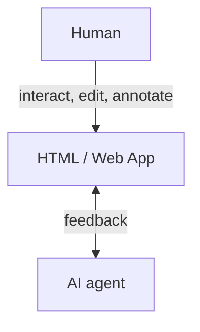

# Humagent

[](https://github.com/souljorje/humagent/actions/workflows/check.yml)
[](LICENSE)

**Collaborate with AI-agent in HTML: make edits, leave comments, generate interactive plans.**

Works with any harness. Runs on your computer. Needs no account or API key.



## Install

Requires Node.js 24+, or Bun 1.4.4+.

```sh
npm i -g humagent
```

Or run without installation:

```sh
npx humagent@latest
```

## Quick start

Install the agent skill:

```sh
humagent setup
```

Try demo:

```sh
humagent demo
```

Or open your own file or local app:

```sh
humagent open ./page.html

humagent open http://127.0.0.1:3000
```

Generate an interactive page:

> Read the Humagent skill. Create an interactive plan for next feature and open it in Humagent.

## Docs

- [Usage](docs/USAGE.md)
- [CLI](docs/CLI.md)
- [SDK](docs/SDK.md)
- [Security](docs/SECURITY.md)
- [Contributing](CONTRIBUTING.md)

## Inspiration

Humagent inspired with [Lavish AXI](https://github.com/kunchenguid/lavish-axi) and [Human Review](https://github.com/petergyang/human-review).

## Licence

[MIT License](LICENSE)