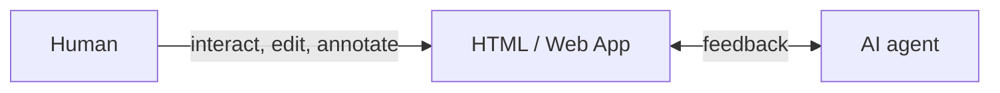

# Humagent

[](https://github.com/souljorje/humagent/actions/workflows/check.yml)
[](LICENSE)

**Collaborate with your AI agent in HTML: make edits, leave comments, and generate interactive plans.**

Works with any harness. Runs on your computer. Needs no account or API key.



[](./docs/humagent.png)

## Features

- Attach comments to any element, or rewrite page text in place. Source files stay unchanged until the agent applies feedback.
- The floating bar collects comments, edits, and form answers into one review.
- Drafts save on the server, so they survive reloads, restarts, and other tabs.
- Marked forms turn agent questions into choices. The [SDK](docs/SDK.md) adds programmatic input.
- Sandboxed frames and loopback-only serving. Read [Security and limits](docs/SECURITY.md).

## Install

Requires Node.js 24+, or Bun 1.4.4+.

```sh
npm i -g humagent
```

Or run without installation:

```sh
npx humagent@latest
```

Building from source works too. See [Contributing](CONTRIBUTING.md#setup).

## Quick start

Install the agent skill:

```sh
humagent setup
```

Try demo:

```sh
humagent demo
```

Or open your own file or local app:

```sh
humagent open ./page.html

humagent open http://127.0.0.1:3000
```

Generate an interactive page:

> Read the Humagent skill. Create an interactive plan for next feature and open it in Humagent.

## Docs

- [Usage](docs/USAGE.md)
- [CLI](docs/CLI.md)
- [SDK](docs/SDK.md)
- [Security](docs/SECURITY.md)
- [Contributing](CONTRIBUTING.md)

## Contribute

Open an issue for bugs and feature requests. Report vulnerabilities privately through the [security policy](SECURITY.md). Read [Contributing](CONTRIBUTING.md) before your first pull request.

## Inspiration

Humagent is inspired by [Lavish AXI](https://github.com/kunchenguid/lavish-axi) and [Human Review](https://github.com/petergyang/human-review).

## License

[MIT License](LICENSE)
