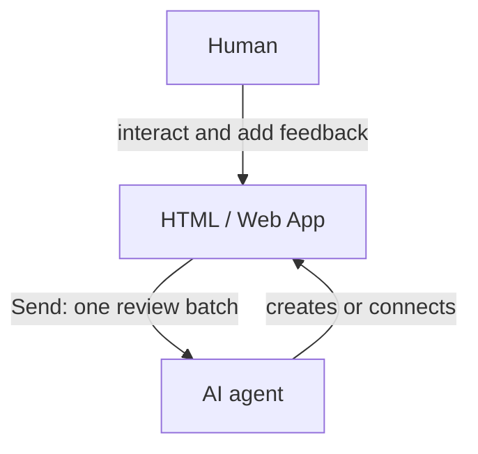

# Humagent

[](https://github.com/souljorje/humagent/actions/workflows/check.yml)
[](LICENSE)

Review existing pages or generate interactive pages with your AI agent.
Collect comments, local text edits, and structured decisions. Send them together as one feedback batch.
The agent applies authorized changes to source files.



## Install

Use Node.js 24 or later. Bun 1.4.4 or later is an alternative runtime.
Installed archives contain compiled code. npm and npx users do not need Bun.

This branch contains version **0.1.0**, which is not published to npm. No GitHub release archive is available yet.
[Build an archive](CONTRIBUTING.md#build-an-archive) before trying these examples.
Run the following commands from the directory that contains `humagent-0.1.0.tgz`.

```sh
npx --yes --package ./humagent-0.1.0.tgz humagent --help
npx --yes --package ./humagent-0.1.0.tgz humagent setup
```

After npm publication, the equivalent prefix is `npx --yes humagent@0.1.0`.
Do not use that registry command before the package exists.
Global installation is optional:

```sh
npm install --global ./humagent-0.1.0.tgz
```

## Review an existing page

Open the existing-page example:

```sh
npx --yes --package ./humagent-0.1.0.tgz humagent demo existing
```

For your own page, use `open ./page.html` instead of `demo existing`.
For a running local app, use `open http://127.0.0.1:3000`.
Humagent attaches its review interface automatically. The application keeps its renderer and normal interactions.

Ask your agent to read `.agents/skills/humagent/SKILL.md` and run the command shown in the expanded bar.
The command includes the current session ID. Wait for **Agent listening** before sending feedback.

## Generate an interactive page

Ask your agent to create `review.html` in the archive directory. This example stages structured choices:

```html
<!doctype html>
<html lang="en">
  <meta charset="utf-8">
  <title>Review a plan</title>
  <h1>Choose the next step</h1>
  <form id="plan" data-humagent-intent="revise_plan" data-humagent-persist>
    <label>Approach
      <select name="approach">
        <option value="pilot">Pilot first</option>
        <option value="platform">Platform first</option>
      </select>
    </label>
    <button type="submit">Add choices to review</button>
  </form>
</html>
```

Open the generated page:

```sh
npx --yes --package ./humagent-0.1.0.tgz humagent open ./review.html
```

Ask your agent to connect with the command in the bar. Submit the form, then choose **Send**.
Forms stage decisions. They do not send feedback or authorize the agent to execute a plan.

## Give feedback

Enable commenting in the floating bar. Click an element to comment, or click plain text to edit its local preview.
Press Enter to confirm. Click a numbered marker to edit saved feedback.
Disable commenting for normal page interactions.

Collect several items and an overall instruction before choosing **Send**. An overall instruction is not required.
Text previews never change source files. The agent reads the batch, edits source, and acknowledges its receipt.

[Usage](docs/USAGE.md) · [CLI](docs/CLI.md) · [Forms and SDK](docs/SDK.md) · [Security](docs/SECURITY.md)

## Development

See [CONTRIBUTING.md](CONTRIBUTING.md) for setup, checks, and release procedures.
Coding agents must follow [AGENTS.md](AGENTS.md).

## Attribution

Humagent draws inspiration from [Lavish AXI](https://github.com/kunchenguid/lavish-axi) and [Human Review](https://github.com/petergyang/human-review).
Element-targeting code adapts work by Kun Chen. Text-context code derives from work by Peter Yang.

| Source | Revision and file |
| --- | --- |
| Lavish AXI | [`69bf309`, `src/artifact-sdk.js`](https://github.com/kunchenguid/lavish-axi/blob/69bf3090b24a04773ffd05d2e0b23d91ca41923b/src/artifact-sdk.js) |
| Human Review | [`dbcb7a6`, `src/anchor-text.js`](https://github.com/petergyang/human-review/blob/dbcb7a69fa4739c4245ee178468f2bc2d6fb2991/src/anchor-text.js) |

Humagent uses the [MIT License](LICENSE). The following notices accompany adapted code and remain in every package.

### Third-party notices

<details>
<summary>Element targeting: copyright and MIT license</summary>

```text
MIT License

Copyright (c) 2026 Kun Chen

Permission is hereby granted, free of charge, to any person obtaining a copy
of this software and associated documentation files (the "Software"), to deal
in the Software without restriction, including without limitation the rights
to use, copy, modify, merge, publish, distribute, sublicense, and/or sell
copies of the Software, and to permit persons to whom the Software is
furnished to do so, subject to the following conditions:

The above copyright notice and this permission notice shall be included in all
copies or substantial portions of the Software.

THE SOFTWARE IS PROVIDED "AS IS", WITHOUT WARRANTY OF ANY KIND, EXPRESS OR
IMPLIED, INCLUDING BUT NOT LIMITED TO THE WARRANTIES OF MERCHANTABILITY,
FITNESS FOR A PARTICULAR PURPOSE AND NONINFRINGEMENT. IN NO EVENT SHALL THE
AUTHORS OR COPYRIGHT HOLDERS BE LIABLE FOR ANY CLAIM, DAMAGES OR OTHER
LIABILITY, WHETHER IN AN ACTION OF CONTRACT, TORT OR OTHERWISE, ARISING FROM,
OUT OF OR IN CONNECTION WITH THE SOFTWARE OR THE USE OR OTHER DEALINGS IN THE
SOFTWARE.
```

</details>

<details>
<summary>Text context: copyright and MIT license</summary>

```text
MIT License

Copyright (c) 2026 Peter Yang

Permission is hereby granted, free of charge, to any person obtaining a copy
of this software and associated documentation files (the "Software"), to deal
in the Software without restriction, including without limitation the rights
to use, copy, modify, merge, publish, distribute, sublicense, and/or sell
copies of the Software, and to permit persons to whom the Software is
furnished to do so, subject to the following conditions:

The above copyright notice and this permission notice shall be included in all
copies or substantial portions of the Software.

THE SOFTWARE IS PROVIDED "AS IS", WITHOUT WARRANTY OF ANY KIND, EXPRESS OR
IMPLIED, INCLUDING BUT NOT LIMITED TO THE WARRANTIES OF MERCHANTABILITY,
FITNESS FOR A PARTICULAR PURPOSE AND NONINFRINGEMENT. IN NO EVENT SHALL THE
AUTHORS OR COPYRIGHT HOLDERS BE LIABLE FOR ANY CLAIM, DAMAGES OR OTHER
LIABILITY, WHETHER IN AN ACTION OF CONTRACT, TORT OR OTHERWISE, ARISING FROM,
OUT OF OR IN CONNECTION WITH THE SOFTWARE OR THE USE OR OTHER DEALINGS IN THE
SOFTWARE.
```

</details>
