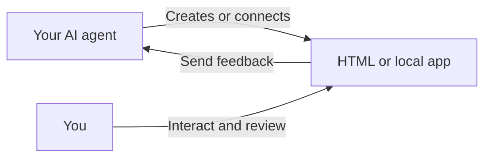

# Humagent

[](https://github.com/souljorje/humagent/actions/workflows/check.yml)
[](LICENSE)

**Review existing pages or create interactive pages with your AI agent.** Comment, preview text edits, and make choices. Send one feedback batch for the agent to apply to source.



## Install

Version **0.1.0** on this branch is not yet published to npm. Build a local archive with Bun 1.4.4+:

```sh
git clone --branch codex/unified-review https://github.com/souljorje/humagent.git
cd humagent
bun install --frozen-lockfile
bun run build
bun pm pack --ignore-scripts --destination .local
npm install --global ./.local/humagent-0.1.0.tgz
```

The installed CLI runs on Node.js 24+ or Bun 1.4.4+. It needs no build step or model API key. After publication, `npx humagent@latest` will work without building an archive.

## Quick start

From your project directory, install the agent skill:

```sh
humagent setup
```

**Review an existing page:**

```sh
humagent demo existing
# Or open your own file or local app:
humagent open ./page.html
humagent open http://127.0.0.1:3000
```

**Generate an interactive page:**

```sh
humagent demo plan
```

Or create a `review.html`:

```html
<!doctype html>
<title>Plan</title>
<form data-humagent-intent="revise_plan">
  <label>Approach
    <select name="approach">
      <option value="pilot-first">Pilot first</option>
    </select>
  </label>
  <button>Add to review</button>
</form>
```

Open it with `humagent open ./review.html`, or ask your agent:

> Read the Humagent skill. Create an interactive plan with choices, open it in Humagent, and wait for my review.

The floating bar shows the session's `humagent wait` command. Ask your agent to run it in its active chat.

## Give feedback

Enable commenting to annotate elements or edit eligible text in a **local preview**. Use numbered markers to revisit feedback. Add an overall instruction if needed, then choose **Send**.

Forms marked with `data-humagent-intent` and calls to `window.humagent.submit()` add structured choices to the same review. They do not send immediately.

The agent edits the underlying source and explains the result in its own chat. Humagent never saves preview text as source.

[Usage](docs/USAGE.md) · [CLI](docs/CLI.md) · [Forms and SDK](docs/SDK.md) · [Security](docs/SECURITY.md) · [Contributing](CONTRIBUTING.md)

## Attribution

Humagent draws inspiration from [Lavish AXI](https://github.com/kunchenguid/lavish-axi) and [Human Review](https://github.com/petergyang/human-review).
Element-targeting code adapts work by Kun Chen. Text-context code derives from work by Peter Yang.

| Source | Revision and file |
| --- | --- |
| Lavish AXI | [`69bf309`, `src/artifact-sdk.js`](https://github.com/kunchenguid/lavish-axi/blob/69bf3090b24a04773ffd05d2e0b23d91ca41923b/src/artifact-sdk.js) |
| Human Review | [`dbcb7a6`, `src/anchor-text.js`](https://github.com/petergyang/human-review/blob/dbcb7a69fa4739c4245ee178468f2bc2d6fb2991/src/anchor-text.js) |

Humagent uses the [MIT License](LICENSE). The following notices accompany adapted code and remain in every package.

### Third-party notices

<details>
<summary>Element targeting: copyright and MIT license</summary>

```text
MIT License

Copyright (c) 2026 Kun Chen

Permission is hereby granted, free of charge, to any person obtaining a copy
of this software and associated documentation files (the "Software"), to deal
in the Software without restriction, including without limitation the rights
to use, copy, modify, merge, publish, distribute, sublicense, and/or sell
copies of the Software, and to permit persons to whom the Software is
furnished to do so, subject to the following conditions:

The above copyright notice and this permission notice shall be included in all
copies or substantial portions of the Software.

THE SOFTWARE IS PROVIDED "AS IS", WITHOUT WARRANTY OF ANY KIND, EXPRESS OR
IMPLIED, INCLUDING BUT NOT LIMITED TO THE WARRANTIES OF MERCHANTABILITY,
FITNESS FOR A PARTICULAR PURPOSE AND NONINFRINGEMENT. IN NO EVENT SHALL THE
AUTHORS OR COPYRIGHT HOLDERS BE LIABLE FOR ANY CLAIM, DAMAGES OR OTHER
LIABILITY, WHETHER IN AN ACTION OF CONTRACT, TORT OR OTHERWISE, ARISING FROM,
OUT OF OR IN CONNECTION WITH THE SOFTWARE OR THE USE OR OTHER DEALINGS IN THE
SOFTWARE.
```

</details>

<details>
<summary>Text context: copyright and MIT license</summary>

```text
MIT License

Copyright (c) 2026 Peter Yang

Permission is hereby granted, free of charge, to any person obtaining a copy
of this software and associated documentation files (the "Software"), to deal
in the Software without restriction, including without limitation the rights
to use, copy, modify, merge, publish, distribute, sublicense, and/or sell
copies of the Software, and to permit persons to whom the Software is
furnished to do so, subject to the following conditions:

The above copyright notice and this permission notice shall be included in all
copies or substantial portions of the Software.

THE SOFTWARE IS PROVIDED "AS IS", WITHOUT WARRANTY OF ANY KIND, EXPRESS OR
IMPLIED, INCLUDING BUT NOT LIMITED TO THE WARRANTIES OF MERCHANTABILITY,
FITNESS FOR A PARTICULAR PURPOSE AND NONINFRINGEMENT. IN NO EVENT SHALL THE
AUTHORS OR COPYRIGHT HOLDERS BE LIABLE FOR ANY CLAIM, DAMAGES OR OTHER
LIABILITY, WHETHER IN AN ACTION OF CONTRACT, TORT OR OTHERWISE, ARISING FROM,
OUT OF OR IN CONNECTION WITH THE SOFTWARE OR THE USE OR OTHER DEALINGS IN THE
SOFTWARE.
```

</details>
