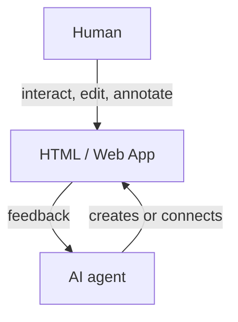

# Humagent

[](https://github.com/souljorje/humagent/actions/workflows/check.yml)
[](LICENSE)

Collaborate with AI-agent in HTML: make edits, leave comments, generate interactive plans.



Works with your harness. Runs on your computer. Needs no account or API key.

## Use cases

- Interactive plans and reports
- Disposable prototypes
- Design refinement

## Install

Requires Node.js 24+, or Bun 1.4.4+.

```sh
npm i -g humagent
```

```sh
npx humagent@latest
```

## Quick start

1. Install the agent skill:

```sh
humagent setup
```

2. Open a local page or the built-in demo. Run one of these commands:

```sh
humagent demo
```

Use `humagent open http://127.0.0.1:3000` for a local app.

3. Ask your agent:

> Read `.agents/skills/humagent/SKILL.md`. Wait for feedback from the open page.

[Commands](docs/CLI.md) · [Forms and SDK](docs/SDK.md) · [Security and limits](docs/SECURITY.md)

## Contributing

Contributions are welcome. See [CONTRIBUTING.md](https://github.com/souljorje/humagent/blob/main/CONTRIBUTING.md).

## Inspiration

Humagent is inspired by [Lavish AXI](https://github.com/kunchenguid/lavish-axi) and [Human Review](https://github.com/petergyang/human-review).

## Licence

Humagent uses the [MIT License](LICENSE)
