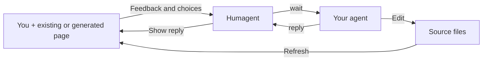

# Humagent

**Review pages and work through decisions with your AI agent.**

Open local HTML, a prototype, or a development app. Leave comments, propose text changes, or submit choices to your existing agent.

## How it works



Humagent runs locally without a model service or API key. It collects no telemetry. Your agent applies source edits.

## Start

Requires **Node.js 22+** or **Bun 1.4.4+**.

**Before npm publication:** download `humagent-0.1.0.tgz` from a successful [CI run](https://github.com/souljorje/humagent/actions).

```sh
npm install --global ./humagent-0.1.0.tgz
humagent demo
```

**After publication:**

```sh
npx humagent@latest demo
# Alternatives
bunx --bun humagent@latest demo
pnpm dlx humagent@latest demo
```

For global installation, use `npm install --global humagent`. The package needs no build step.

## Connect your agent

```sh
humagent setup
```

Then ask your agent:

> Read `.agents/skills/humagent/SKILL.md`. Open my page in Humagent and wait for feedback.

Or ask it to create a page:

> Read the Humagent skill. Create an interactive plan for this task and wait for my choices.

Use `setup --directory PATH` for another skill directory. Setup preserves modified instructions unless you pass `--force`.

Opening a page does not start an agent. Input stays queued until your agent runs `wait` in an active turn.

## Open your work

```sh
humagent open ./proposal.html
humagent open http://127.0.0.1:3000
```

Humagent opens a browser workspace and prints a private URL and session ID. Use `--no-open` to open the URL yourself.

| Mode | Use |
| --- | --- |
| **Interact** | Use the page normally. |
| **Annotate** | Select text or an element and leave a comment. |
| **Propose edit** | Enter an exact replacement for your agent to apply. |

Use the conversation panel for other requests. Press Escape inside the page to return to Interact mode.

When source changes, use the refresh notice. Humagent keeps drafts and opted-in form values, but application state can reset.

Other examples: `humagent demo calculator` and `humagent demo existing`. Demos use editable copies and preserve your changes.

## Add choices to a page

Mark a form to send its named values to the agent:

```html
<form
  id="plan"
  data-humagent-intent="revise_plan"
  data-humagent-message="Revise the plan. Do not execute it."
  data-humagent-persist
>
  <label>
    Approach
    <select name="approach">
      <option value="pilot-first">Pilot first</option>
      <option value="platform-first">Platform first</option>
    </select>
  </label>
  <button type="submit">Revise plan</button>
</form>
```

`revise_plan` describes a request. It needs no server handler and grants no permission to execute the plan.

Custom interfaces can use `window.humagent.submit()`. See the [SDK guide](docs/SDK.md) for forms, saved state, and replies.

## Limits and privacy

Supports local HTML and supported HTTP localhost apps. Remote sites, cookie authentication, Markdown rendering, and MCP Apps are not included.

Use trusted pages. Keep session URLs private. Do not expose the server publicly. Session data stays under `~/.humagent` unless you set `--home` or `HUMAGENT_HOME`.

Local HTML blocks external resources unless you pass `--network`. App security policies, service workers, and server settings can prevent proxy attachment.

[Commands and troubleshooting](docs/CLI.md) · [Security](docs/SECURITY.md)

## Development

Before PR #1 merges, clone the implementation branch:

```sh
git clone --branch feat/initial-runtime https://github.com/souljorje/humagent.git
cd humagent
bun install --frozen-lockfile
bun run build
bun dist/cli.js demo
```

[Contribute](https://github.com/souljorje/humagent/blob/feat/initial-runtime/CONTRIBUTING.md) · [Build and publish](https://github.com/souljorje/humagent/blob/feat/initial-runtime/docs/RELEASE.md)

## Inspiration and license

Humagent is inspired by [Lavish AXI](https://github.com/kunchenguid/lavish-axi) and [Human Review](https://github.com/petergyang/human-review).

Some targeting and text-anchoring helpers adapt their MIT-licensed code. Neither project is a runtime dependency.

Targeting helpers derive from revision `69bf3090b24a04773ffd05d2e0b23d91ca41923b`, file `src/artifact-sdk.js`.
Text anchors derive from revision `dbcb7a69fa4739c4245ee178468f2bc2d6fb2991`, file `src/anchor-text.js`.

Humagent uses the [MIT License](LICENSE). The notices below apply to the adapted helpers.

### Source credits

| Helper | Project | Author |
| --- | --- | --- |
| `web/vendor/targets.js` | [Lavish](https://github.com/kunchenguid/lavish-axi) | Kun Chen |
| `web/vendor/anchors.js` | [Human Review](https://github.com/petergyang/human-review) | Peter Yang |

### Third-party notices

Keep these notices with copies of the adapted helpers. The npm package includes this README.

<details>
<summary>Element targeting helpers: copyright and MIT license</summary>

```text
MIT License

Copyright (c) 2026 Kun Chen

Permission is hereby granted, free of charge, to any person obtaining a copy
of this software and associated documentation files (the "Software"), to deal
in the Software without restriction, including without limitation the rights
to use, copy, modify, merge, publish, distribute, sublicense, and/or sell
copies of the Software, and to permit persons to whom the Software is
furnished to do so, subject to the following conditions:

The above copyright notice and this permission notice shall be included in all
copies or substantial portions of the Software.

THE SOFTWARE IS PROVIDED "AS IS", WITHOUT WARRANTY OF ANY KIND, EXPRESS OR
IMPLIED, INCLUDING BUT NOT LIMITED TO THE WARRANTIES OF MERCHANTABILITY,
FITNESS FOR A PARTICULAR PURPOSE AND NONINFRINGEMENT. IN NO EVENT SHALL THE
AUTHORS OR COPYRIGHT HOLDERS BE LIABLE FOR ANY CLAIM, DAMAGES OR OTHER
LIABILITY, WHETHER IN AN ACTION OF CONTRACT, TORT OR OTHERWISE, ARISING FROM,
OUT OF OR IN CONNECTION WITH THE SOFTWARE OR THE USE OR OTHER DEALINGS IN THE
SOFTWARE.
```

</details>

<details>
<summary>Text anchoring helpers: copyright and MIT license</summary>

```text
MIT License

Copyright (c) 2026 Peter Yang

Permission is hereby granted, free of charge, to any person obtaining a copy
of this software and associated documentation files (the "Software"), to deal
in the Software without restriction, including without limitation the rights
to use, copy, modify, merge, publish, distribute, sublicense, and/or sell
copies of the Software, and to permit persons to whom the Software is
furnished to do so, subject to the following conditions:

The above copyright notice and this permission notice shall be included in all
copies or substantial portions of the Software.

THE SOFTWARE IS PROVIDED "AS IS", WITHOUT WARRANTY OF ANY KIND, EXPRESS OR
IMPLIED, INCLUDING BUT NOT LIMITED TO THE WARRANTIES OF MERCHANTABILITY,
FITNESS FOR A PARTICULAR PURPOSE AND NONINFRINGEMENT. IN NO EVENT SHALL THE
AUTHORS OR COPYRIGHT HOLDERS BE LIABLE FOR ANY CLAIM, DAMAGES OR OTHER
LIABILITY, WHETHER IN AN ACTION OF CONTRACT, TORT OR OTHERWISE, ARISING FROM,
OUT OF OR IN CONNECTION WITH THE SOFTWARE OR THE USE OR OTHER DEALINGS IN THE
SOFTWARE.
```

</details>
