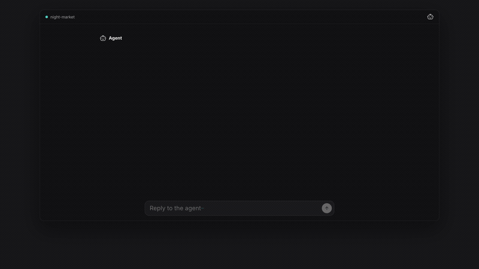

# Humagent

This branch contains an unpublished [Bun executable experiment](docs/bun-standalone-experiment.md).
Its executable includes the Bun runtime and the built browser assets.
The existing JavaScript package remains the comparison build.

[](https://github.com/souljorje/humagent/actions/workflows/check.yml?query=branch%3Amain)
[](https://www.npmjs.com/package/humagent)
[](LICENSE)

**Collaborate with your AI agent in HTML: make edits, leave comments, and generate interactive plans.**

Works with any harness. Runs locally. Needs no account or API key.

[](https://github.com/souljorje/humagent/blob/main/assets/humagent-demo.gif)

### Use cases

- Interactive plans and reports
- Disposable prototypes
- Design refinement

## Quick start

Requires Node.js 24+, or Bun 1.4.4+.

```sh
npm i -g humagent
```

Run without installation:

```sh
npx humagent@latest
```

Try demo:

```sh
humagent demo
```

Or open your own file or local app:

```sh
humagent ./page.html
```

## Agent skill

```sh
npx skills add souljorje/humagent
```

Use with Agent:

```text
/humagent ./page.html
```

Generate an interactive page:

> Create an interactive plan for next feature using /humagent.

## Docs

- [Usage](docs/usage.md): annotate, edit, send, recover
- [Reference](docs/reference.md): commands, page API, feedback format
- [Glossary](docs/GLOSSARY.md): names used in code, documents, and the interface
- [Development](docs/development.md): checks, architecture, plugins, release
- [Contributing](CONTRIBUTING.md): local setup
- [Security](SECURITY.md): trust model and limits
- [Edit the demo video](assets/humagent-film/README.md)

## Contribute

Open an issue for bugs and feature requests. Report vulnerabilities privately through the [security policy](SECURITY.md). Read [Contributing](CONTRIBUTING.md) before your first pull request.

## Inspiration

Humagent is inspired by [Lavish AXI](https://github.com/kunchenguid/lavish-axi) and [Human Review](https://github.com/petergyang/human-review).

## License

[MIT License](LICENSE)
